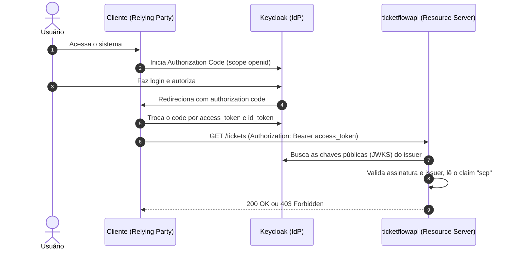
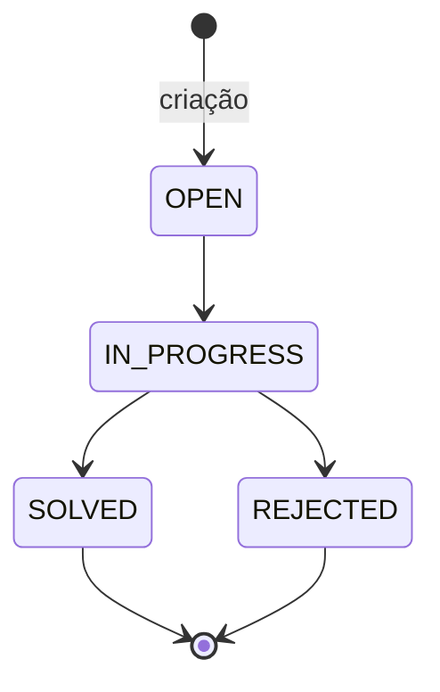
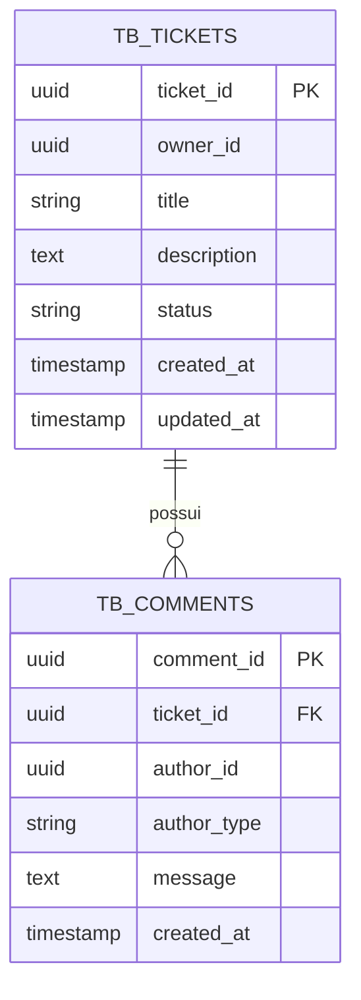

# TicketFlow + Keycloak

API REST de **chamados de suporte** (tickets) protegida com **OAuth2 / OpenID Connect** usando o [Keycloak](https://www.keycloak.org/) como Identity Provider.

O projeto serve de laboratório para um cenário bem comum no dia a dia: uma API que **não faz login por conta própria**. Ela apenas valida o JWT emitido pelo Keycloak e decide o que cada pessoa pode fazer a partir dos *scopes* presentes no token.

## Sumário

- [Visão geral](#visão-geral)
- [Stack](#stack)
- [Como funciona a autenticação](#como-funciona-a-autenticação)
- [Início rápido](#início-rápido)
- [Configuração do Keycloak](#configuração-do-keycloak)
- [Obtendo um token e chamando a API](#obtendo-um-token-e-chamando-a-api)
- [Endpoints](#endpoints)
- [Regras de negócio](#regras-de-negócio)
- [Modelo de dados](#modelo-de-dados)
- [Estrutura do projeto](#estrutura-do-projeto)
- [Configuração](#configuração)
- [Testes](#testes)

## Visão geral

| Papel no fluxo OIDC | Quem é neste projeto |
|---|---|
| Identity Provider (IdP) | Keycloak (`http://localhost:8080`) |
| Resource Server | `ticketflowapi` (`http://localhost:8081`) |
| Relying Party / cliente | Qualquer aplicação ou ferramenta que obtenha o token (front-end, Insomnia, Postman, `curl`) |

Existem dois perfis de uso, distinguidos pelos scopes do token:

- **Suporte**: enxerga todos os tickets, move o status e responde nos chamados.
- **Usuário (dono do ticket)**: abre tickets e só enxerga e comenta nos **seus próprios** tickets (scopes com prefixo `own:`).
## Stack

| Componente | Versão |
|---|---|
| Java | 21 |
| Spring Boot | 4.1.2 |
| Spring Security (OAuth2 Resource Server) | via starter do Boot |
| Spring Data JPA + Hibernate | via starter do Boot |
| PostgreSQL | 18.1 (Docker) |
| Keycloak | 26.5.0 (Docker, modo `start-dev`) |
| Build | Maven (wrapper incluso) |

## Como funciona a autenticação

O Keycloak implementa o fluxo **Authorization Code** do OIDC. O cliente redireciona a pessoa para o login, recebe um *authorization code* e o troca por um `access_token` (JWT). Esse token é enviado à API no header `Authorization: Bearer <token>`.



Na API (`SecurityConfig`):

- Toda requisição exige autenticação (`anyRequest().authenticated()`).
- A sessão é *stateless* e CSRF/CORS estão desabilitados (adequado para laboratório; veja [Configuração](#configuração)).
- As permissões vêm do claim **`scp`** do JWT, convertido em *authorities* **sem prefixo** (`tickets:list`, `own:tickets:read`, etc.).
- Cada endpoint usa `@PreAuthorize` para exigir o scope correspondente.
- O `issuer-uri` aponta para o realm `ticketflow-realm`; é dele que a API baixa as chaves para validar a assinatura.
## Início rápido

### Pré-requisitos

- [JDK 21](https://adoptium.net/)
- [Docker](https://www.docker.com/) com Docker Compose
- Git
### 1. Clonar o repositório

```bash
git clone https://github.com/OliverBR1/ticketflow-keycloak.git
cd ticketflow-keycloak
```

### 2. Subir a infraestrutura (Postgres + Keycloak)

```bash
cd infra
docker compose up -d
```

Serviços criados:

| Serviço | Porta | Credenciais |
|---|---|---|
| Postgres dos tickets (`ticketing`) | `5432` | usuário `ticketing` / senha `password` |
| Postgres do Keycloak (`keycloak`) | interna | usuário `keycloak` / senha `password` |
| Keycloak | `8080` | console admin: `admin` / `admin` |

> Todas as senhas acima são **apenas para desenvolvimento local**.

### 3. Configurar o Keycloak

O repositório **não inclui um export do realm**, então é preciso criá-lo uma vez. Siga [Configuração do Keycloak](#configuração-do-keycloak) e volte aqui.

### 4. Subir a API

Linux / macOS / Git Bash:

```bash
cd ticketflowapi
./mvnw spring-boot:run
```

Windows (PowerShell):

```powershell
cd ticketflowapi
.\mvnw.cmd spring-boot:run
```

A API sobe em `http://localhost:8081`. As tabelas `tb_tickets` e `tb_comments` são criadas automaticamente (`ddl-auto=update`).

> **Importante:** a API valida o `issuer-uri` na inicialização. Se o Keycloak ainda não estiver de pé, ou se o realm `ticketflow-realm` não existir, a aplicação falha ao subir.

## Configuração do Keycloak

Acesse `http://localhost:8080` e entre com `admin` / `admin`.

O que a API espera encontrar:

1. **Realm** chamado `ticketflow-realm` (o nome precisa bater com o `issuer-uri`).
2. **Um client** para obter tokens (nos testes deste projeto, um client público chamado `frontend`, com PKCE, usando `https://oidcdebugger.com/debug` como redirect URI).
3. **Um claim `scp` no access token**, do tipo **lista de strings**, contendo os scopes abaixo. O Keycloak não gera o claim `scp` por padrão, então ele é produzido com um *protocol mapper* que preenche o `scp` com as **roles do realm** do usuário. Na prática: crie no realm uma role para cada scope da tabela abaixo (com o mesmo nome) e atribua ao usuário. Um usuário só com `default-roles-ticketflow-realm` recebe `403` nos endpoints.
4. **Usuários** de teste, cada um com as roles do seu perfil (por exemplo, um usuário comum `bruno` e um de suporte `joao`).
   Scopes usados pela API:

| Scope | Perfil típico | Permite |
|---|---|---|
| `tickets:create` | Usuário | Criar ticket |
| `own:tickets:list` | Usuário | Listar os próprios tickets |
| `own:tickets:read` | Usuário | Ler os próprios tickets |
| `own:tickets-comments:create` | Usuário | Comentar nos próprios tickets |
| `tickets:list` | Suporte | Listar todos os tickets |
| `tickets:read` | Suporte | Ler qualquer ticket |
| `tickets-status:update` | Suporte | Alterar o status de um ticket |
| `tickets-comments:create` | Suporte | Comentar em qualquer ticket |

> 💡
## Obtendo um token e chamando a API

O jeito mais fiel ao fluxo real é usar **Authorization Code** no Postman ou no Insomnia (OAuth 2.0 → Authorization Code) apontando para o realm:

- Authorization URL: `http://localhost:8080/realms/ticketflow-realm/protocol/openid-connect/auth`
- Token URL: `http://localhost:8080/realms/ticketflow-realm/protocol/openid-connect/token`
  Para testes rápidos por linha de comando, se o seu client tiver **Direct Access Grants** habilitado:

```bash
TOKEN=$(curl -s -X POST \
  "http://localhost:8080/realms/ticketflow-realm/protocol/openid-connect/token" \
  -d "grant_type=password" \
  -d "client_id=<SEU_CLIENT_ID>" \
  -d "username=<USUARIO>" \
  -d "password=<SENHA>" \
  -d "scope=openid" | jq -r .access_token)
```

Conferir quem você é e quais scopes o token carrega:

```bash
curl -s http://localhost:8081/me -H "Authorization: Bearer $TOKEN" | jq
```

Criar um ticket:

```bash
curl -i -X POST http://localhost:8081/tickets \
  -H "Authorization: Bearer $TOKEN" \
  -H "Content-Type: application/json" \
  -d '{"title": "Impressora parou", "description": "A impressora do 2º andar não responde."}'
```

A resposta traz `201 Created` com o header `Location: /tickets/{id}`.

## Endpoints

Todos exigem `Authorization: Bearer <access_token>`.

| Método | Rota | Scope exigido | Descrição |
|---|---|---|---|
| `GET` | `/me` | qualquer token válido | Retorna os claims do JWT (útil para depuração) |
| `GET` | `/tickets` | `tickets:list` ou `own:tickets:list` | Lista todos os tickets (suporte) ou só os do usuário |
| `GET` | `/tickets/{id}` | `tickets:read` ou `own:tickets:read` | Detalha um ticket com seus comentários |
| `POST` | `/tickets` | `tickets:create` | Cria um ticket com status `OPEN` |
| `PATCH` | `/tickets/{id}/status` | `tickets-status:update` | Altera o status do ticket |
| `POST` | `/tickets/{ticketId}/comments` | `tickets-comments:create` ou `own:tickets-comments:create` | Adiciona um comentário |

### Exemplos de corpo

`POST /tickets`

```json
{ "title": "Impressora parou", "description": "A impressora do 2º andar não responde." }
```

`PATCH /tickets/{id}/status`

```json
{ "status": "IN_PROGRESS" }
```

`POST /tickets/{ticketId}/comments`

```json
{ "message": "Já estamos verificando o equipamento." }
```

### Códigos de resposta

| Código | Quando acontece |
|---|---|
| `200` | Leitura/listagem ou comentário adicionado com sucesso |
| `201` | Ticket criado |
| `204` | Status atualizado |
| `401` | Token ausente, expirado ou inválido |
| `403` | Token válido, mas sem o scope necessário, ou ticket de outra pessoa |
| `404` | Ticket não encontrado |
| `422` | Regra de negócio violada (transição de status inválida ou ticket fora de andamento) |

## Regras de negócio

**Ciclo de vida do ticket:**



- Um ticket novo sempre nasce como `OPEN`.
- Só é possível ir de `OPEN` para `IN_PROGRESS`, e de `IN_PROGRESS` para `SOLVED` ou `REJECTED`. Qualquer outra transição retorna `422`.
- **Comentários só são aceitos com o ticket em `IN_PROGRESS`**; caso contrário, `422`.
- Quem comenta com `tickets-comments:create` é registrado como `SUPPORT`; quem comenta com `own:tickets-comments:create` é registrado como `USER` e precisa ser o dono do ticket (senão, `403`).
- O dono do ticket (`owner_id`) e o autor do comentário (`author_id`) são o `sub` do JWT, ou seja, o id do usuário no Keycloak.
## Modelo de dados



`owner_id` e `author_id` guardam o id do usuário no Keycloak; **não há tabela de usuários** na API.

## Estrutura do projeto

```text
ticketflow-keycloak/
├── infra/
│   └── docker-compose.yml          # Postgres (tickets), Postgres (Keycloak) e Keycloak
└── ticketflowapi/
    ├── pom.xml
    └── src/main/java/tech/oliver/ticketflowapi/
        ├── config/
        │   └── SecurityConfig.java # Resource Server, conversão do claim "scp"
        ├── controller/
        │   ├── TicketController.java
        │   ├── CommentController.java
        │   ├── UserController.java
        │   └── dto/                # Records de entrada e saída
        ├── entities/               # Ticket, TicketComment, enums
        └── repository/             # Repositórios Spring Data JPA
```

## Configuração

Principais propriedades em `ticketflowapi/src/main/resources/application.properties`:

| Propriedade | Valor padrão | Observação |
|---|---|---|
| `server.port` | `8081` | Porta da API |
| `spring.datasource.url` | `jdbc:postgresql://localhost:5432/ticketing` | Banco dos tickets |
| `spring.datasource.username` / `password` | `ticketing` / `password` | Mesmo valor do `docker-compose.yml` |
| `spring.jpa.hibernate.ddl-auto` | `update` | Bom para desenvolvimento; use migrations (Flyway/Liquibase) em produção |
| `spring.security.oauth2.resourceserver.jwt.issuer-uri` | `http://localhost:8080/realms/ticketflow-realm` | Realm do Keycloak |

### ⚠️ Antes de levar para produção

Este projeto está configurado para **desenvolvimento local**. Ajuste, no mínimo:

- Senhas e credenciais fora do repositório (variáveis de ambiente ou secret manager).
- Keycloak em modo `start` (não `start-dev`), com HTTPS e hostname configurados.
- CORS configurado explicitamente (hoje está desabilitado) caso um front-end em outro domínio consuma a API.
- Validação dos DTOs de entrada (por exemplo, Bean Validation em `title`, `description` e `message`).
- `ddl-auto=validate` com migrations versionadas.
## Testes

```bash
cd ticketflowapi
./mvnw test        # Windows PowerShell: .\mvnw.cmd test
```

Atualmente existe apenas o teste de contexto (`TicketflowapiApplicationTests`). O projeto já inclui as dependências `spring-security-oauth2-resource-server-test` e `webmvc-test`, que permitem simular JWTs com scopes específicos nos testes dos controllers.

